# CrossNext 2.1.0

[English](README.md) · [Instalación](docs/install.md) · [Descargas](https://github.com/manuelx900/CrossNext/releases)

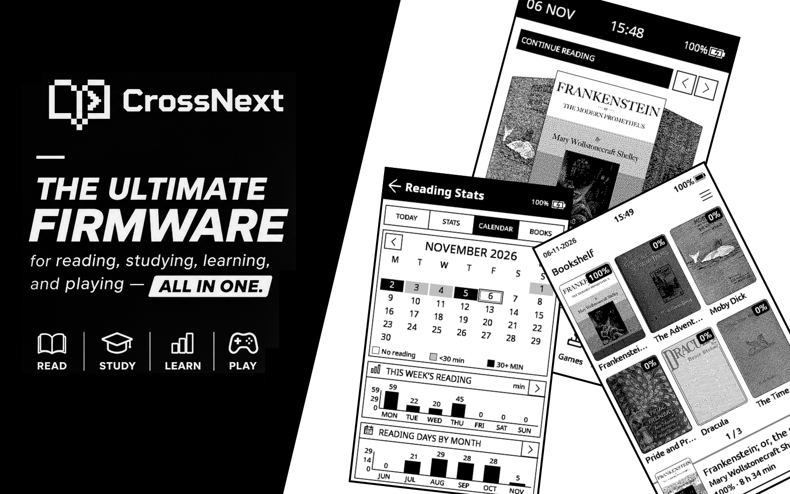

CrossNext es un firmware de código abierto para **Xteink X4 Pro (ESP32-S3)**.
Reúne lectura EPUB, biblioteca, estadísticas, herramientas de estudio, apps y juegos.
**CrossNext 2.1.0 está basado en [CrossPoint 2.0.0](https://github.com/crosspoint-reader/crosspoint-reader/releases/tag/2.0.0)**, con la base de apps y juegos heredada de [CrossPlay 1.14.2](https://github.com/ma-r-s/crossplay/releases/tag/v1.14.2).
Estos paquetes son para X4 Pro: no los instales en X4 ni X3.

## Instalar o actualizar

Descarga el firmware y los recursos de [CrossNext 2.1.0](https://github.com/manuelx900/CrossNext/releases/tag/2.1.0).

La versión 2.1.0 incorpora BookOrbit con catálogo y sincronización automática,
actualiza los iconos de Apps y mejora la respuesta de Inicio y del teclado. [Ver todos los cambios de 2.1.0](docs/releases/2.1.0.md).

Consulta las [novedades de 2.0.5](docs/releases/2.0.5.md), las [novedades de 2.0.4](docs/releases/2.0.4.md), las [novedades de 2.0.3](docs/releases/2.0.3.md), las [novedades de 2.0.2](docs/releases/2.0.2.md) y [todos los cambios desde 1.4.0](docs/releases/2.0.0.md).

Si ya instalaste los recursos de 2.0.7, puedes seguir usándolos.
Guarda una copia de la microSD, incluida la carpeta oculta `/.crosspoint/`, donde están tus partidas y progreso.

1. Si ya tienes una instalación compatible, copia `CrossNext-X4PRO-Firmware-v2.1.0.bin`
   a la tarjeta. Abre **Ajustes → Sistema → Actualizar firmware**, selecciónalo y confirma.
2. Si te faltan los recursos de 2.0.7, guarda tus fuentes y diccionarios personalizados y reemplaza las
   carpetas de recursos antiguas por las de `CrossNext-Resources.zip` en la raíz
   de la microSD. No mezcles paquetes antiguos y nuevos. Conserva los libros,
   las licencias y tus datos de `/.crosspoint/`; reinicia al terminar.
   Consulta la [guía de instalación de recursos](docs/install.md#required-app-contents).
3. Copia tus libros a una carpeta como `/books` y entra en **Archivos** o **Biblioteca**.
   Una configuración nueva empieza en inglés; puedes cambiar el idioma en Configuración.

El archivo `-factory.bin` incluye arranque y particiones: se instala por USB en
`0x0` y **no** se selecciona en el actualizador de la tarjeta. La partición de aplicación
debe tener espacio suficiente; actualizar por SD no cambia la tabla de particiones.
Consulta la [guía de instalación y actualización](docs/install.md).
No borres toda la carpeta `/.crosspoint/` para regenerar portadas ni comparar motores:
también contiene tus datos personales de lectura y apps.

## Leer a tu gusto

Puedes elegir Carrusel, Marco, Carrusel2 o Estantería como inicio. Biblioteca
ofrece Recientes, Colección y Filtrar, con listas o portadas. Las listas muestran
el texto directamente. En la vista de portadas aparece el diseño predeterminado
mientras carga la imagen; los libros sin imagen conservan su portada con nombre.
El aviso de carga del inicio se puede activar por separado para cada apariencia.

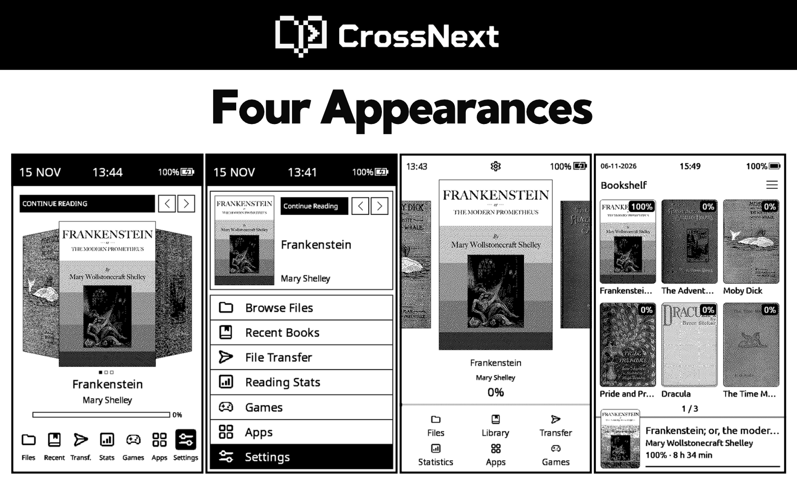

El desplegable inferior permite cambiar fuente, tamaño, grosor, interlineado,
márgenes, alineación y capítulo. El gesto se elige en
**Configuración → Controles → Botones → Abrir ajustes del libro**; por defecto
se abre deslizando desde abajo. La opción independiente **Menú de lectura**
elige entre barra de herramientas y lista: cambia su presentación, no el gesto.

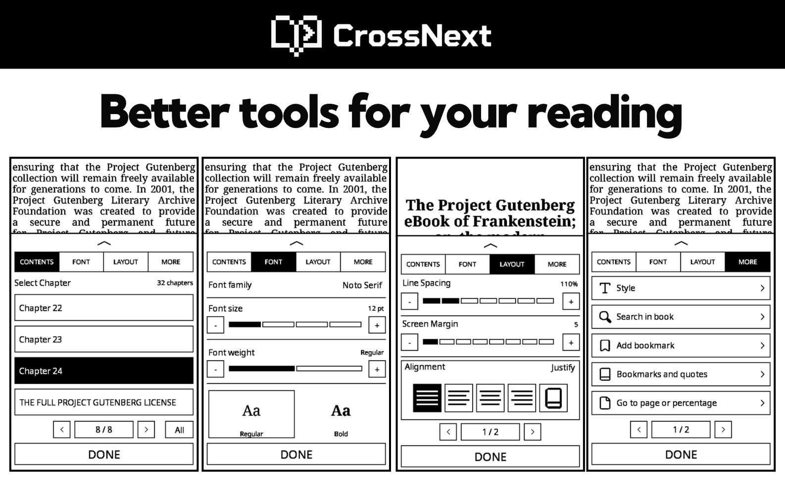
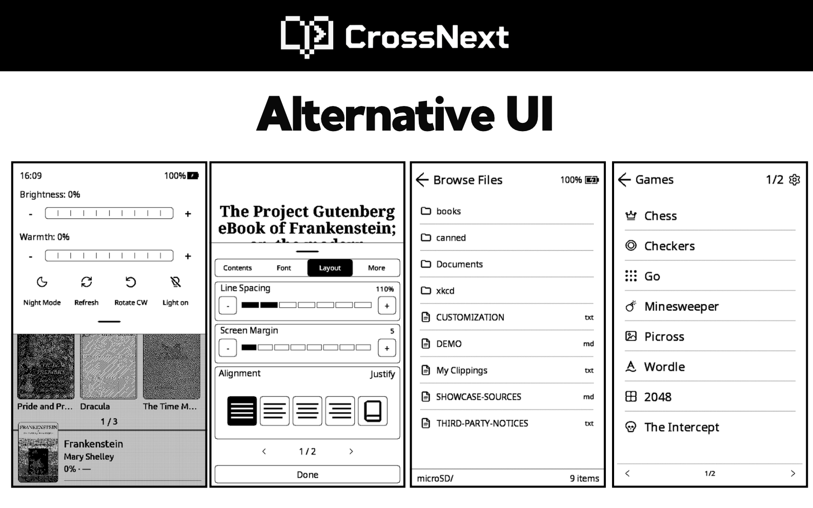

En **Configuración → Lectura → Motor EPUB** puedes elegir **Nuevo** o **Clásico (1.4)**.
Cada motor guarda sus propias páginas preparadas.
[Descarga el EPUB de comparación](docs/downloads/CrossNext-EPUB-Comparison.epub)
y sigue la [guía](docs/epub-engine-comparison.md). Incluye texto largo en inglés,
tipografía y patrones PNG/JPEG idénticos para ambos motores. Compara con los mismos
ajustes y distingue la primera apertura de las siguientes.

## Lectura, estudio y juegos

Las estadísticas muestran tiempo, páginas, sesiones, rachas, calendario y libros terminados.

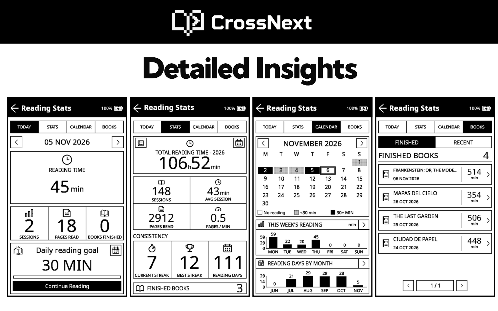

PET crece con tu lectura e incluye cuidados, decoración, recuerdos y generaciones anteriores.

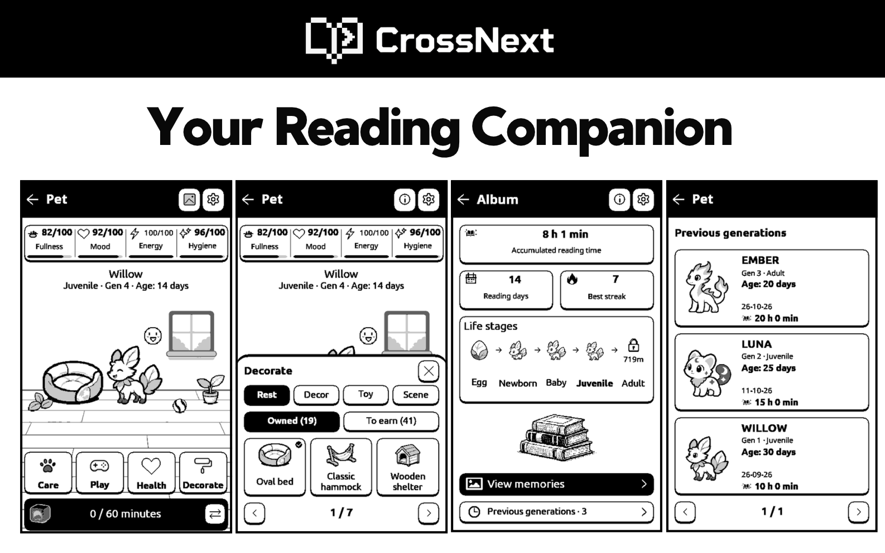

Aventura lectora incluye campaña, cacerías repetibles, equipo y una tienda con
desbloqueos hasta el nivel 150. Cada batalla tiene su propio objetivo: los minutos
sobrantes quedan en las estadísticas y no adelantan otra batalla. Repetir una
cacería da experiencia y monedas; atuendos y demás objetos únicos se obtienen una vez.

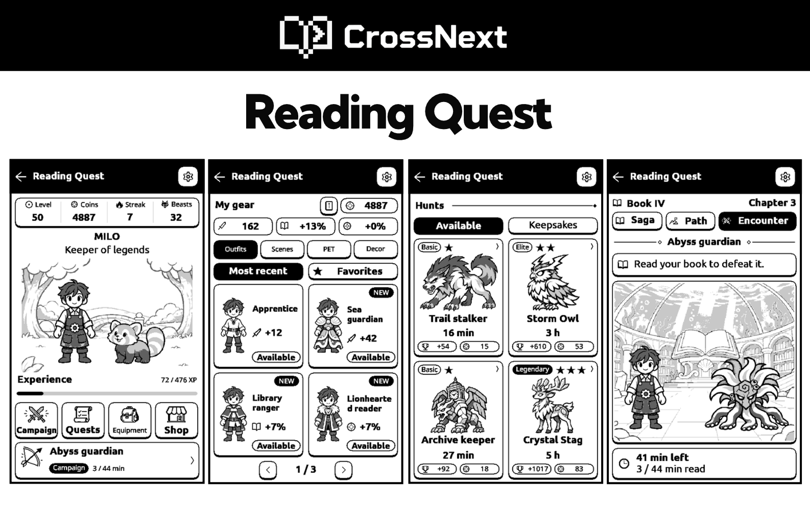

Estudia con Flashcards y Palabras guardadas. También tienes Hábitos, Tareas, Notas,
Pomodoro, Fondos, Citas, Calendario, Reloj, Contador, Focus y Calculadora.

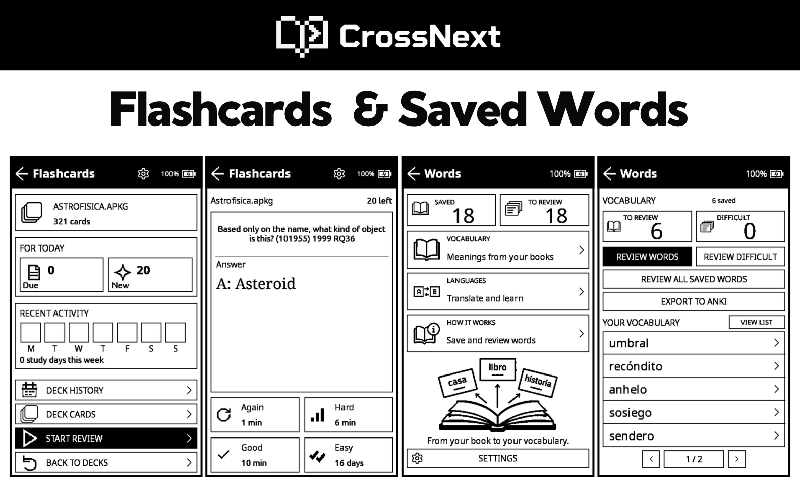
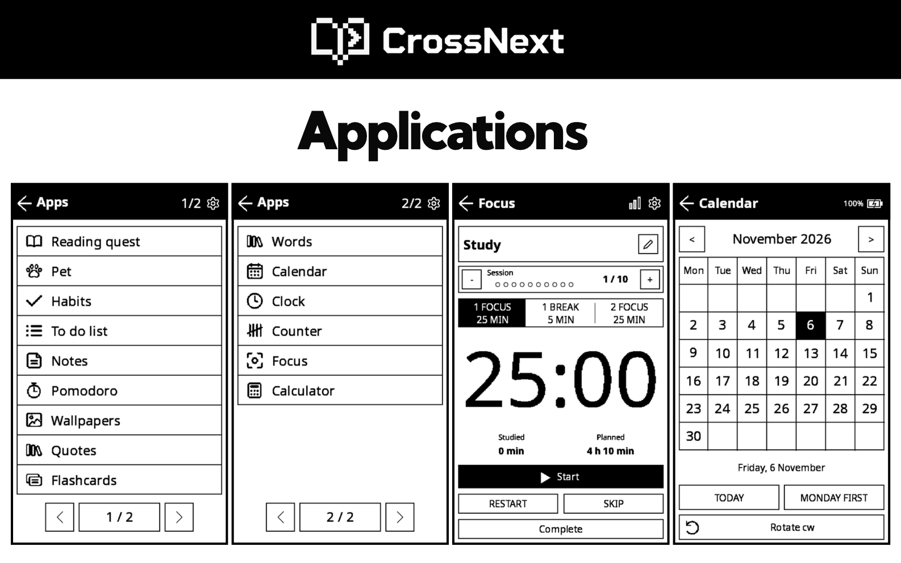

Los juegos incluyen Ajedrez, Damas, Go, Buscaminas, Picross, Wordle, 2048, The Intercept,
Batalla naval, Solitario, Corazones, Murdle, Carnívoro, Cuatro en raya, Sudoku y Othello.

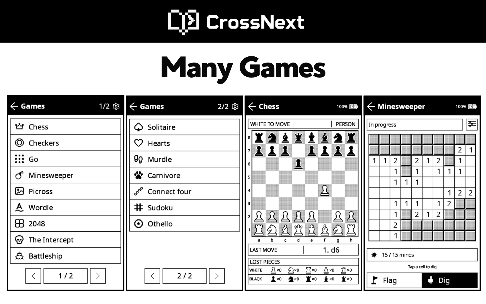

## Preparar libros en el ordenador

**CrossNext Book Preparer 2.0.7** es el programa complementario y opcional para
**Windows y macOS**, compatible con el firmware 2.1.0. [Instaladores de Book Preparer en GitHub](https://github.com/manuelx900/CrossNext/releases/tag/2.0.7)
Prepara la microSD en el ordenador antes de volver al lector,
para que CrossNext pueda reutilizar los resultados y evitar hacer ese trabajo en
el dispositivo. Tus libros se procesan localmente: no se suben a Internet.

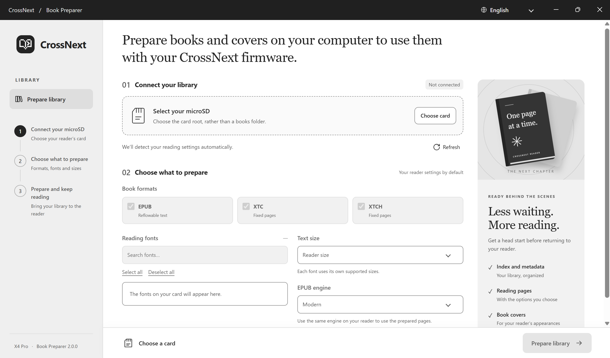

Utiliza el motor real del firmware para generar:

- **Datos de los libros:** metadatos e índices de caché que el lector puede reutilizar.
- **Páginas EPUB:** paginación de capítulos e imágenes procesadas con el motor,
  las fuentes, los tamaños y el diseño de lectura seleccionados.
- **Portadas:** las imágenes con los tamaños que usan las cuatro apariencias de
  inicio y Biblioteca, para libros compatibles EPUB, XTC y XTCH.

1. Cierra el libro, retira la microSD de forma segura y conéctala al ordenador.
2. En Windows abre `CrossNext-Book-Preparer-Windows-v2.0.7.exe`.
   En macOS abre el DMG arm64 (Apple Silicon) o x64 (Intel) y arrastra la app a Aplicaciones.
3. Selecciona la **raíz de la tarjeta**, no la carpeta de libros. El programa lee
   los ajustes del lector y detecta las fuentes de `/fonts` y `/.fonts`.
4. Elige formatos, fuentes y tamaños. Usa el mismo motor EPUB: **Nuevo** en el
   programa (**Modern** en inglés) corresponde a **Nuevo** en el lector; **Clásico**
   corresponde a **Clásico (1.4)**. Pulsa **Preparar biblioteca**.
   Muchas fuentes y tamaños o una biblioteca grande pueden tardar horas y ocupar espacio.
5. Cancelar conserva los resultados terminados. Puedes continuar después y expulsar
   la tarjeta de forma segura al finalizar.

El programa escribe caché generada dentro de `/.crosspoint/` y conserva libros,
ajustes, progreso y estadísticas. Cambiar motor, fuente, tamaño, orientación o diseño
puede necesitar otra paginación. Reutiliza las cachés compatibles.
Los ajustes preparados deben coincidir con los que uses en el lector. Puedes
seguir cambiando la tipografía del libro: el firmware generará cualquier diseño
que falte. El programa adelanta trabajo sin cambiar la calidad visual ni el
tiempo físico de refresco de la pantalla.
Consulta las [instrucciones del preparador](docs/desktop-book-preparer.md) y la
[preparación desde el lector](docs/book-preparation.md).
Los DMG se generan y verifican en macOS. Las apps no tienen notarización de Apple; pueden aparecer avisos de seguridad.

## Créditos y licencias

Conserva [LICENSE](LICENSE), [los avisos de terceros](THIRD-PARTY-NOTICES.md)
y las licencias del SDK y recursos. CrossPlay aporta la base de apps y juegos;
CrossPoint, la base de lectura. Consulta [cambios y referencias](docs/crossnext-changes.md).
El texto original y los patrones del EPUB de prueba se ofrecen bajo CC0 1.0.

## Fuentes e idiomas editables

Las fuentes completas de lectura se instalan desde Resources en `/fonts`,
incluidas Noto Serif y la Noto Sans opcional. Ubuntu queda como respaldo
residente. Las versiones pequeñas de Noto Sans/Noto Serif para la interfaz
siguen en el firmware; son independientes de la fuente del libro.

Los idiomas de Resources permiten corregir traducciones. En `languages` hay
una plantilla CSV, fuentes de traducción legibles y una guía. Conserva las claves
y los marcadores de formato, corrige el texto y compila el `.cplang` con
`tools_local/language_packs.py`; no abras el binario para modificarlo como texto.
Copia el archivo al mismo directorio de la tarjeta y reinicia. Al informar una
traducción dudosa, indica el idioma y la pantalla. Consulta la
[guía de idiomas](docs/language-packs.md).

Los dos EPUB adjuntos son originales y **están solo en inglés**:
[comparación de motores](docs/downloads/CrossNext-EPUB-Comparison.epub) y
[demostración del lector](docs/downloads/CrossNext-Reader-Showcase.epub).
En Controles → Botones → Abrir ajustes del libro también puedes elegir tocar
el borde inferior o el superior. El gesto predeterminado sigue siendo deslizar
desde abajo.

