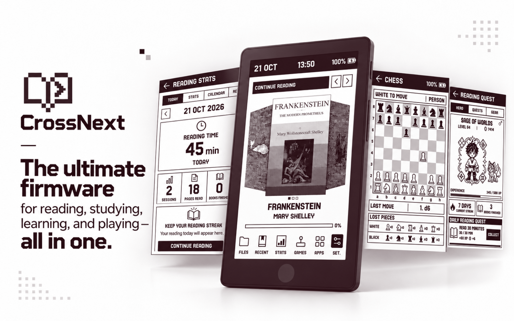
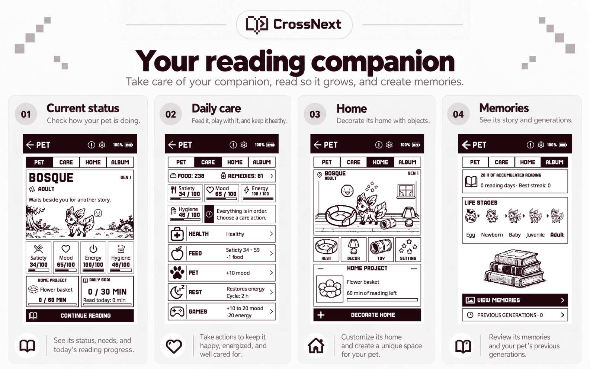
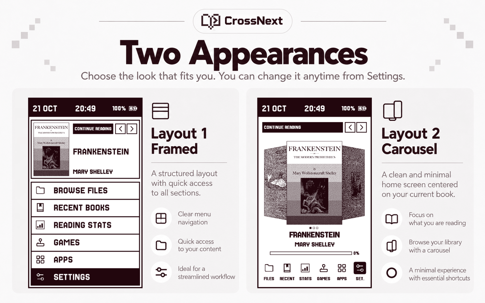
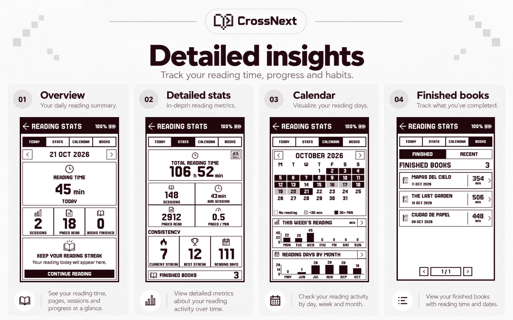
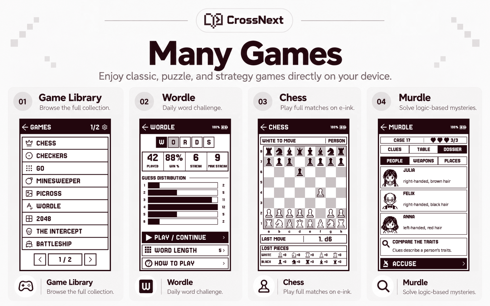
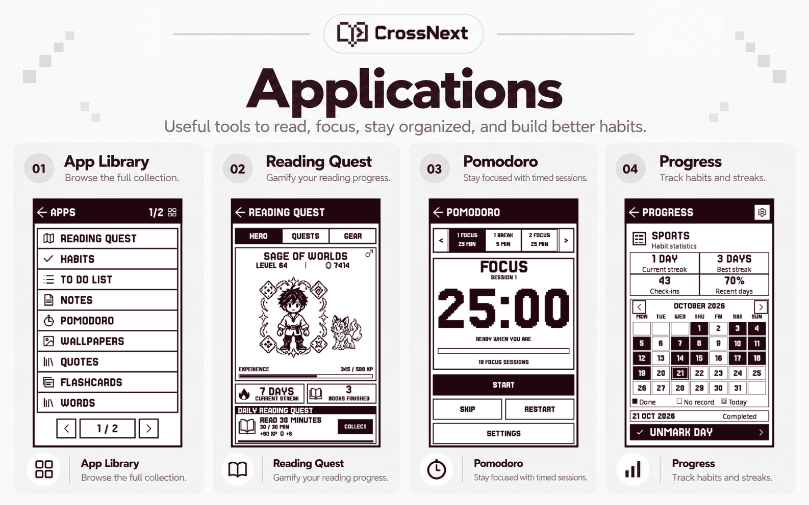
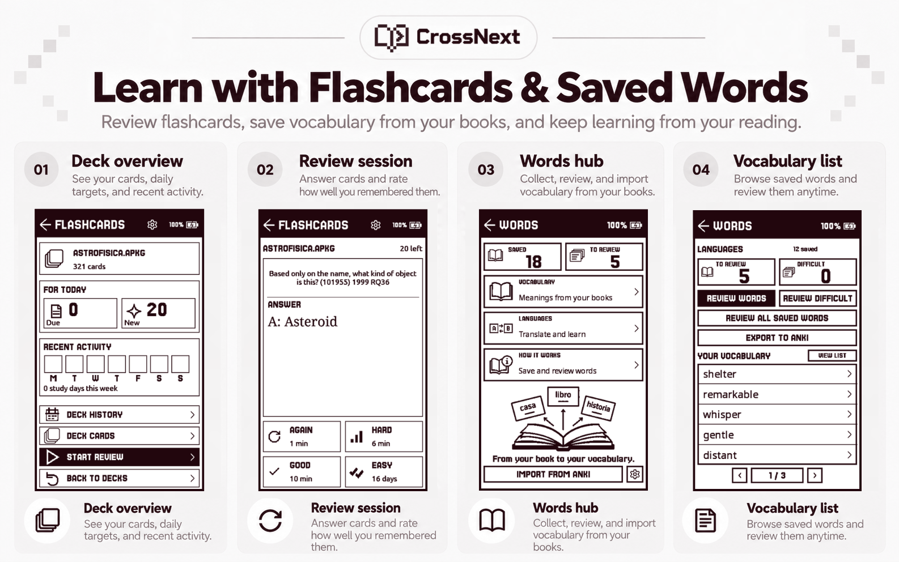
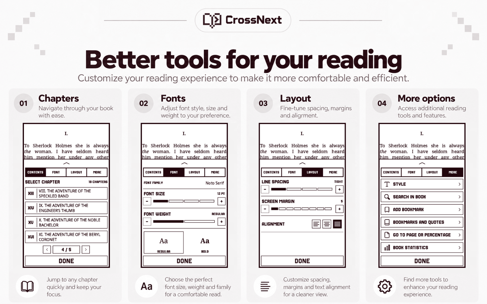
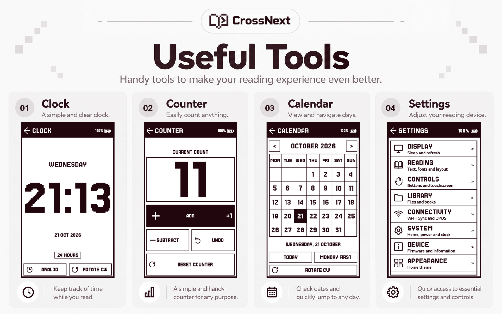

<h1 align="center">
   
  CrossNext
</h1>

[Español](README.es.md) · [Changes and upstream credits](docs/crossnext-changes.md) · [Installation](docs/install.md)

CrossNext brings reading, study tools and games to the **Xteink X4 Pro**.
Read a book, save new vocabulary, review flashcards, track your reading and take
a break with a game, all on the same e-ink device.

Choose a framed Home screen or a cover carousel, arrange your own app and game
shortcuts, and adjust the fonts, reading controls and sleep wallpapers to suit you.
This release supports **X4 Pro only** (ESP32-S3).

CrossNext is based on [CrossPlay 1.14.2](https://github.com/ma-r-s/crossplay)
and [CrossPoint 1.6.5](https://github.com/crosspoint-reader/crosspoint-reader),
with the FreeInk SDK. The reader and most games and apps come from those projects.
CrossNext adapts their interface, navigation and study workflows. Additional
references include [CrossInk](https://github.com/uxjulia/CrossInk),
[CrossDiTo](https://github.com/dito94/CrossDiTo) and
[VCodex](https://github.com/franssjz/cpr-vcodex); see the [credits](docs/crossnext-changes.md).

## PET: your reading companion

PET turns your reading routine into a story with a virtual companion. Choose an
egg, name your pet and watch it grow as you read.

- **Reading statistics:** follow your reading time, reading days and streaks.
- **Difficulty and goals:** adjust the care difficulty and daily reading goal
  to suit your routine.
- **Daily care:** feed, clean and care for your pet, keeping an eye on its
  needs and health.
- **Games and affection:** pet your companion and play minigames to lift its mood.
- **A home of its own:** unlock furnishings through reading and arrange its
  room to your liking.
- **Memories and generations:** discover memories as you progress, follow your
  pet's life stages and revisit previous generations.

Install **CrossNext-Resources.zip** on the microSD to use PET.
See [PET's guide](docs/apps/pet.md) and
[what's new in v1.2.0](docs/releases/CrossNext-v1.2.0.md).

## Read, study and play

- EPUB, text, Markdown and XTC/XTCH reading, a file browser and a cover library.
- Reading history, statistics, calendars and Reading Quest.
- Flashcards imported from files/Anki, local FSRS review and a saved vocabulary app.
- Independent title/question and content sizes: 10, 12, 14, 16 and 18 pt.
  Smart sizing is enabled by default; long text keeps complete pagination.
- Horizontal paging in supported app/puzzle selectors and study cards.
- Anki image zoom uses a separate high-resolution copy only while enlarged;
  normal cards keep the small preview. Rotation toggles between two positions.
- Pomodoro's physical button starts and pauses; XTC/XTCH can reverse swipes
  and page-tap zones for manga reading.

The active shelf contains these **16 games**:
Chess (including puzzles), Checkers, Go, Minesweeper, Picross, Wordle, 2048,
The Intercept, Battleship, Solitaire, Hearts, Murdle, Carnivore, Connect Four,
Sudoku and Othello.

Its **13 app entries** are Reading Quest, PET, Habits, To Do List, Notes, Pomodoro,
Wallpapers, Quotes, Flashcards, Words, Calendar, Clock and Counter.

Fresh settings start in **English**. Spanish is available in the language
settings; an existing installation keeps its saved language.

## In pictures

### Two Home layouts

### Reading statistics

Optional **CrossPoint Sync** keeps your account history and new local reading in one statistics view. Read offline, then use the sync shortcut beside the battery to synchronize statistics and book positions together. Each book on the microSD keeps the furthest position from the reader or your account. The shortcut appears only after configuring a compatible sync account. See [reading statistics](docs/reading-stats.md#crosspoint-sync).

### Games

### Apps and productivity

### Flashcards and saved words

### Reading controls

### Everyday tools

## Install it

Choose the package matching the device:

| Model | ZIP | Application / SD update | Factory / USB installation |
| --- | --- | --- | --- |
| X4 Pro | `CrossNext-X4PRO-Firmware-v1.2.0.zip` | `CrossNext-X4PRO-Firmware-v1.2.0.bin` | `CrossNext-X4PRO-Firmware-v1.2.0-factory.bin` |

Generated ZIPs are in `dist/`, and raw images in `dist/CrossNext/`.
Each firmware ZIP includes SHA-256 checksums, model-specific images and notes.
Application images belong in a compatible SD updater/OTA slot, or at `0x10000`;
factory images contain the bootloader and partitions and belong at `0x0` over USB.
Read [the installation guide](docs/install.md) and back up the microSD first.
The plain X4/X3 use another chip; these packages do not target them or PaperMono.

Use **Settings → Device → Check for Updates** to get updates from
[CrossNext GitHub Releases](https://github.com/manuelx900/CrossNext/releases).
The updater checks for a newer version and asks before installing the X4 Pro
application. Release maintainers attach `CrossNext-X4PRO-OTA.bin` alongside the
versioned ZIP; see [online updates](docs/install.md#online-update-source).

`CrossNext-Resources.zip` contains reader fonts, dictionaries and the contents
required by Reading Quest, PET and The Intercept. Merge its folders into the
microSD root and preserve its licences. Install the updated resources with this
firmware; an older pack may be missing the new app contents.
It contains no firmware or personal reading/game history.

`CrossNext-source.zip` is the clean source export, including required SDK sources,
assets, tests and notices. Firmware/resources ZIPs are release attachments and
do not need to enter the source repository's Git history.

## Try the local simulator

Follow [Windows setup](docs/simulator-windows.md#setup-from-a-source-export), then
run `Start-Simulator.cmd`. The local browser opens `http://127.0.0.1:8765/` and
runs the firmware from these sources. The showcase supplies books with original
notices, synthetic statistics, files and saved app/game examples for screenshots.
It uses separate demonstration data rather than the reader's personal records.

See [the showcase guide](docs/simulator-showcase.md). Browser-specific network
and sleep adaptations are described in [the site documentation](site/README.md).
The original [CrossPlay demo](https://crossplay.ma-r-s.com) is maintained upstream.

## Develop and verify

Use `x4pro` for the device and `simulator_x4_pro` for the simulator;
the upstream `default` environment targets a different chip. In a configured
development checkout, run `./scripts_local/check.sh` from your own worktree.
Use the repository's `./bin/clang-format-fix -g` wrapper for changed C/C++ files.
Read the [contributor guide](docs/contributing/getting-started.md) and
[local script documentation](scripts_local/README.md) before changing firmware.
Inherited CrossPlay automation is restricted to its original repository; CrossNext
releases are published manually.

Useful feature details: [Flashcards](docs/apps/flashcards-ui.md),
[Words](docs/apps/words.md), [Pomodoro](docs/pomodoro.md),
[Library performance](docs/library-performance.md) and
[the render audit](docs/render-performance.md).
Builds, native tests and simulator checks do not replace physical-device testing
of display refresh, SD behavior, memory and all orientations before publication.

## Licence and attribution

Keep [LICENSE](LICENSE), original copyright notices and bundled asset licences.
CrossPlay supplies the app/game shelf and implementations; CrossPoint supplies
the e-reader foundation. [CrossNext changes](docs/crossnext-changes.md) describes
this fork's adaptations without claiming those inherited projects as new work.

[What’s new in v1.2.0](docs/releases/CrossNext-v1.2.0.md)

## Support CrossNext

Thank you for using CrossNext and helping it improve. If you would like to support
its ongoing development, please consider supporting me on Ko-fi.

