# CrossNext 2.1.0

[Español](README.es.md) · [Installation](docs/install.md) · [Releases](https://github.com/manuelx900/CrossNext/releases)

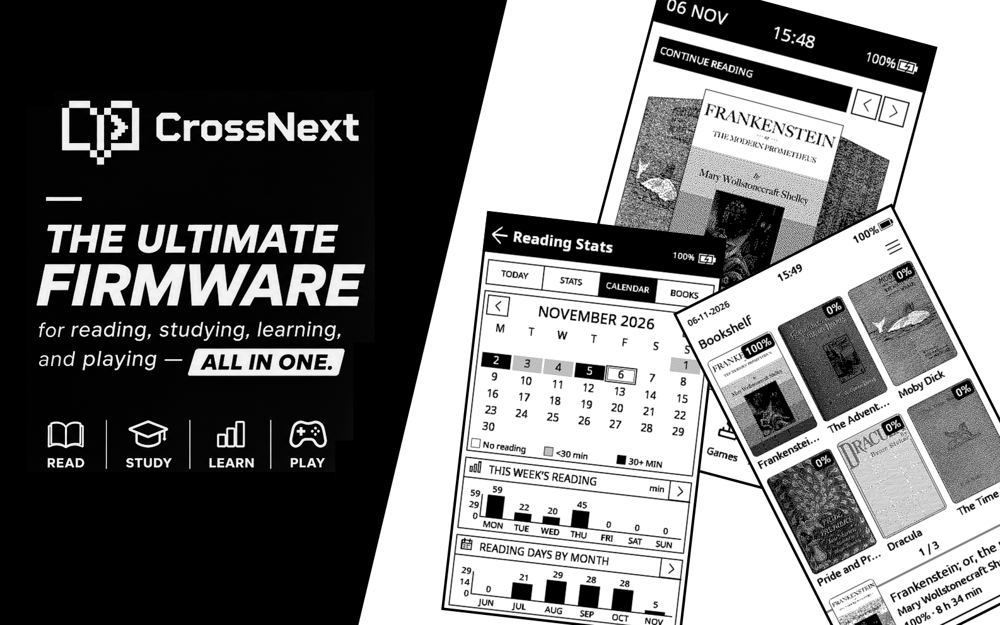

CrossNext is open-source e-reader firmware for **Xteink X4 Pro (ESP32-S3)**.
It combines EPUB reading, a library, reading statistics, study tools, small apps
and games. **CrossNext 2.1.0 is based on [CrossPoint 2.0.0](https://github.com/crosspoint-reader/crosspoint-reader/releases/tag/2.0.0)**, with the app/game foundation inherited from [CrossPlay 1.14.2](https://github.com/ma-r-s/crossplay/releases/tag/v1.14.2).
The packages described here target X4 Pro; do not install them on X4 or X3.

## Install or update

Download the firmware and resources from the [CrossNext 2.1.0 release](https://github.com/manuelx900/CrossNext/releases/tag/2.1.0).

Version 2.1.0 adds BookOrbit with catalogue browsing and automatic sync,
refreshes the Apps icons and improves Home and keyboard responsiveness. [See the full 2.1.0 notes](docs/releases/2.1.0.md).

Read the [2.0.5 release notes](docs/releases/2.0.5.md), the [2.0.4 additions](docs/releases/2.0.4.md), the [2.0.3 additions](docs/releases/2.0.3.md), the [2.0.2 additions](docs/releases/2.0.2.md) and the [full changes from 1.4.0](docs/releases/2.0.0.md).

If you already installed the 2.0.7 resource pack, you can keep using it.
Back up the microSD, including the hidden `/.crosspoint/` folder containing saves.

1. For an existing compatible installation, copy `CrossNext-X4PRO-Firmware-v2.1.0.bin`
   to the card. Open **Settings → System → Update firmware**, select it and confirm.
2. If you are missing the 2.0.7 resources, back up custom fonts and dictionaries, then replace the old bundled
   resource folders with `CrossNext-Resources.zip` at the microSD root. Do not
   merge old and new resource packs. Keep your books, licences and `/.crosspoint/`
   saves and restart after installation. See the [resource installation guide](docs/install.md#required-app-contents).
3. Put books in a normal card folder such as `/books`, then open **Files** or **Library**.
   Fresh settings use English. Change the interface language in Settings.

The `-factory.bin` image is for USB installation at `0x0`, with bootloader and
partitions included. It is **not** an SD updater image. Application slots must
fit the firmware; an SD update cannot enlarge an old partition table.
See [installation, factory flashing and OTA](docs/install.md) for the exact routes.
Never clear the whole `/.crosspoint/` folder to refresh covers or compare engines:
it contains personal reading and app data as well as generated caches.

## Make reading your own

Four home appearances are available: Carousel, Framed, Carousel2 and Bookshelf.
Library offers Recent, Collections and Filter, in list or cover views.
List views show book text directly. Cover views show default book placeholders
while images load; files without cover artwork retain their named fallback.
The home cover-loading notice can be enabled separately for each appearance.

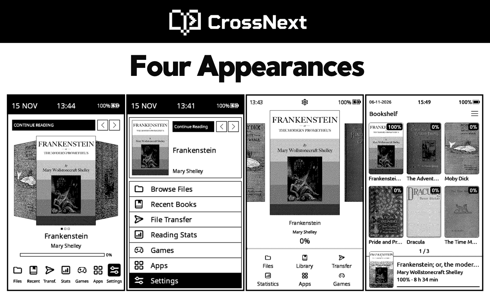

Open the book's lower panel to change font, size, weight, spacing, margins,
alignment and chapters. Configure how it opens under
**Settings → Controls → Buttons → Open book settings**. The default is a swipe
up from the bottom. Top-edge and bottom-edge taps are also available. The separate **Reading menu** option chooses a toolbar or
a list presentation; it does not choose the opening gesture.

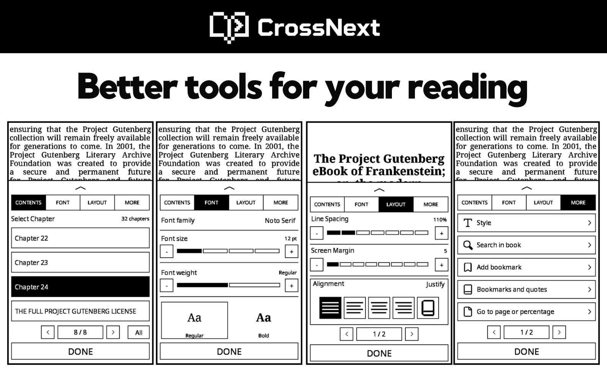
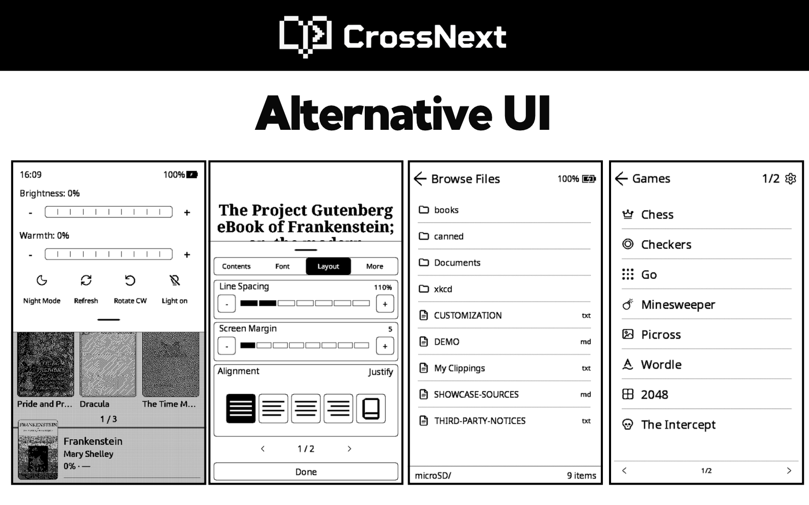

The EPUB engine selector is under **Settings → Reading → EPUB engine**:
**New** or **Classic (1.4)**. Each engine keeps its own prepared pages.
[Download the original comparison EPUB](docs/downloads/CrossNext-EPUB-Comparison.epub)
and follow the [comparison guide](docs/epub-engine-comparison.md).
Both [the comparison book](docs/downloads/CrossNext-EPUB-Comparison.epub) and [the reader showcase](docs/downloads/CrossNext-Reader-Showcase.epub) contain only English. They include numbered passages, typography and PNG/JPEG patterns;
test the same book and layout on your reader, separating cold and warm openings.

## Reading, study and play

Statistics show time, pages, sessions, streaks, calendar and finished books.

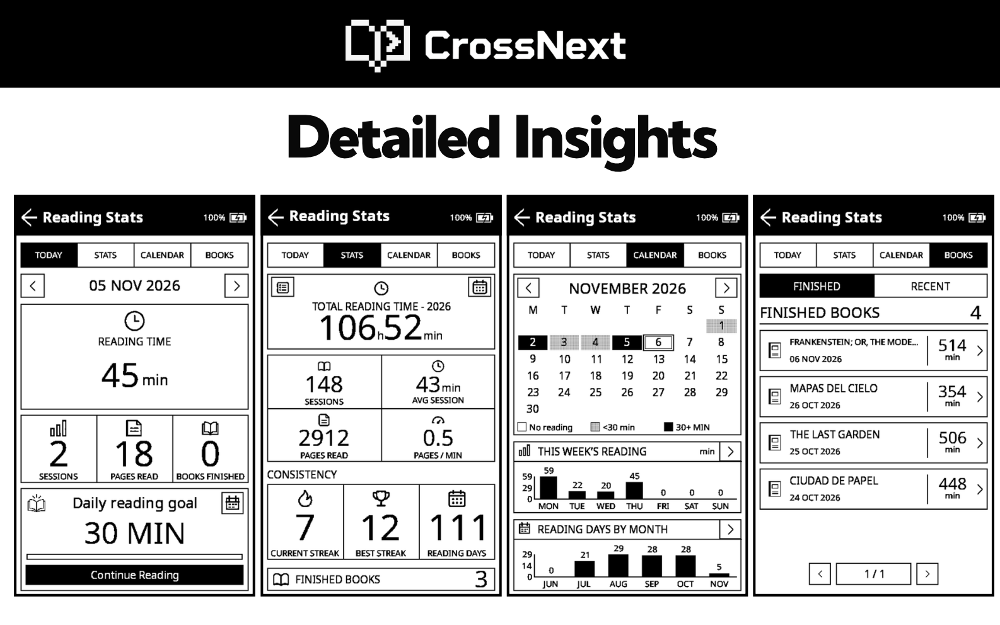

PET grows through reading, with care, decoration, memories and previous generations.

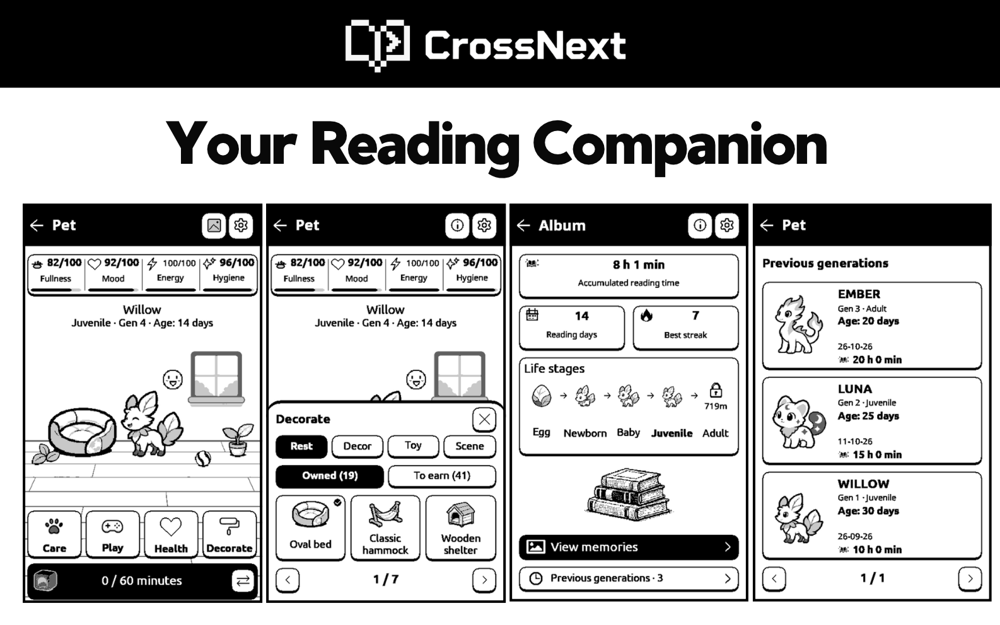

Reading Quest adds a campaign, repeatable Hunts, equipment and a shop extending
through level 150. Every battle has its own reading objective: extra minutes are
recorded in statistics and do not prepay the next battle. Repeat Hunts award EXP
and coins; unique outfits and other objects are obtained once.

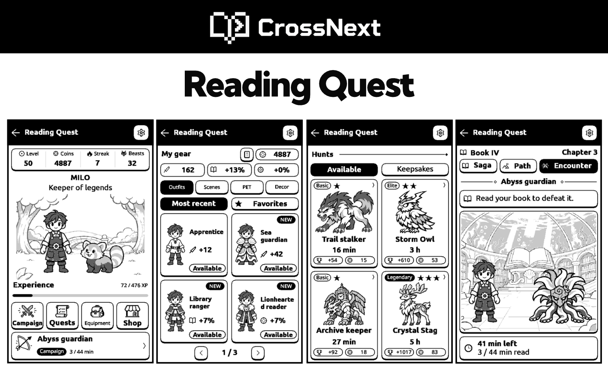

Study with Flashcards and saved Words. Small tools include Habits, Tasks, Notes,
Pomodoro, Wallpapers, Quotes, Calendar, Clock, Counter, Focus and Calculator.

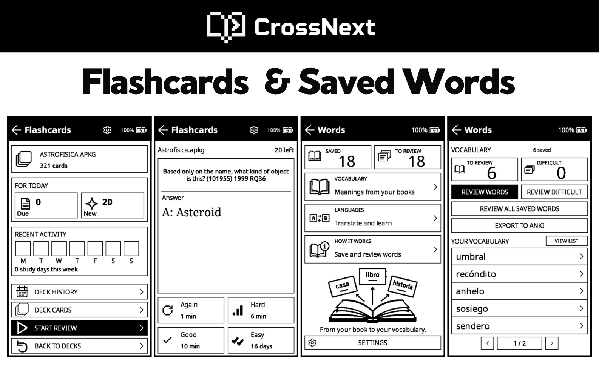
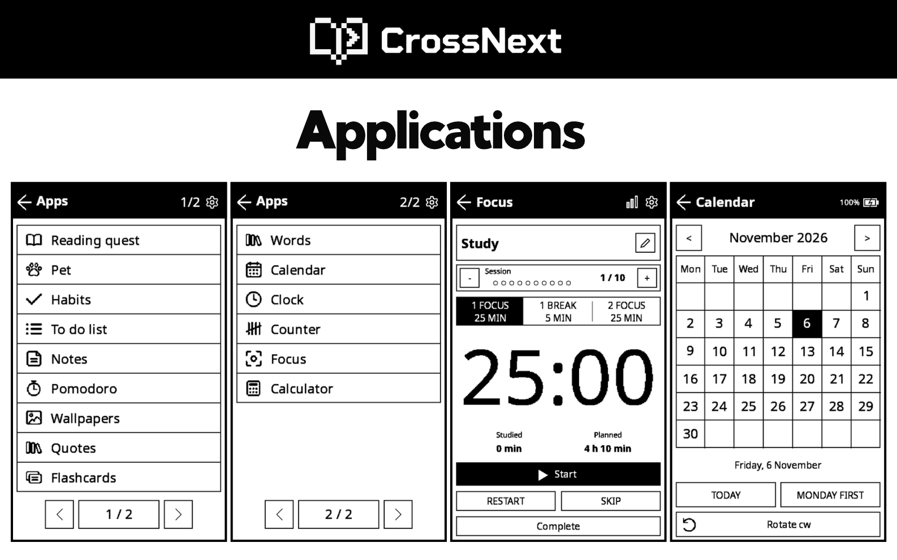

Games include Chess, Checkers, Go, Minesweeper, Picross, Wordle, 2048, The Intercept,
Battleship, Solitaire, Hearts, Murdle, Carnivore, Connect four, Sudoku and Othello.

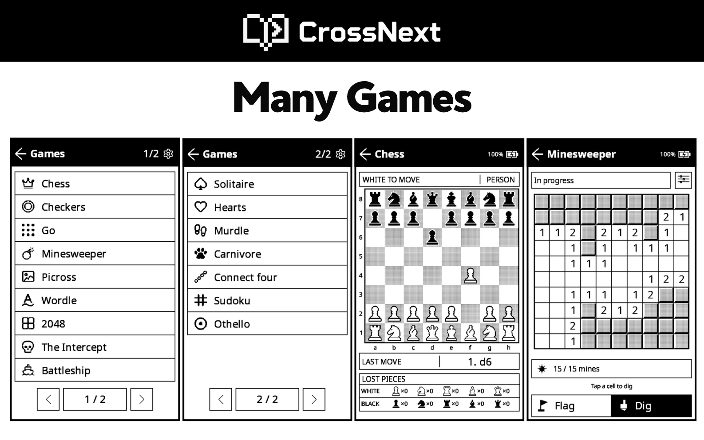

## Prepare books on your computer

**CrossNext Book Preparer 2.0.7** is the optional companion application for
**Windows and macOS**, compatible with firmware 2.1.0. [Book Preparer installers on GitHub](https://github.com/manuelx900/CrossNext/releases/tag/2.0.7)
It prepares your microSD on the computer before you return
to the reader, so CrossNext can reuse the results instead of doing that work on
the device. Your books stay on your computer and card; they are not uploaded.

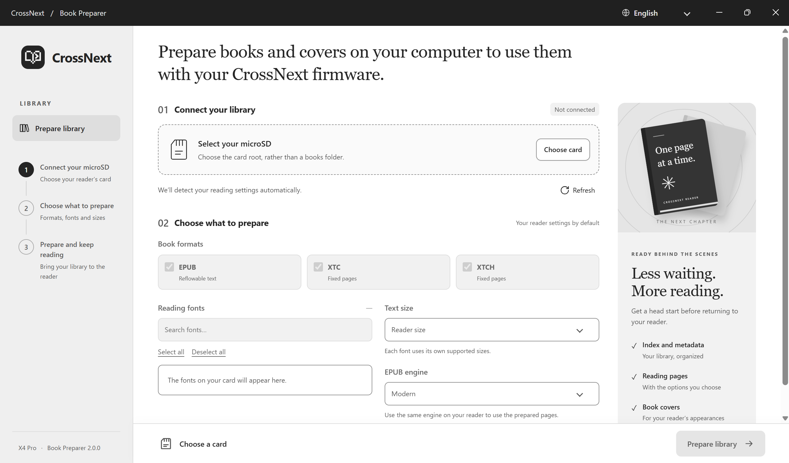

Using the real firmware preparation engine, it generates:

- **Book data:** metadata and cache indexes that the reader can reuse.
- **EPUB pages:** chapter pagination and processed images for your selected
  engine, fonts, sizes and reading layout.
- **Covers:** the image sizes used by the four home appearances and Library,
  for supported EPUB, XTC and XTCH books.

1. Close the book on the reader and safely remove the microSD. Connect it to the computer.
2. Windows: open `CrossNext-Book-Preparer-Windows-v2.0.7.exe`.
   macOS: open the matching arm64 (Apple Silicon) or x64 (Intel) `.dmg` and drag the application to Applications.
3. Select the **card root**, not the books folder. The program detects saved reading
   settings and installed fonts from `/fonts` and `/.fonts`.
4. Choose formats, fonts and sizes. Match the EPUB engine: **Modern** in the program
   corresponds to **New** on the reader; **Classic** corresponds to **Classic (1.4)**.
   Start with **one font and one size**: each EPUB combination stores separate page layouts and selecting many can fill the card.
   Click **Prepare library**, review the combination count and free space, then confirm.
5. Cancel preserves completed outputs. Run again to continue, then safely eject the card.

Use **Clear CrossPoint cache** beside the card's free space to review and remove generated caches by date or all at once. Date mode preserves earlier page files and shared book metadata. Books, settings, progress, vocabulary, statistics and game saves are preserved. Deletion requires a separate confirmation and cannot restore earlier overwritten versions. The app leaves a small free-space reserve during preparation and explains when there is insufficient space.

The program writes generated cache files under `/.crosspoint/` and preserves books,
settings, progress and statistics. Changing engine, font, size, orientation or layout
can require new pages. It reuses compatible caches rather than deleting the library.
The prepared options must match those used on the reader. Preparing a book does
not lock its typography: you can still change it, and the reader will generate
any missing layout. Preparation does not change visual quality or the display's
physical refresh time.
See [Book Preparer instructions](docs/desktop-book-preparer.md) and
[on-reader preparation](docs/book-preparation.md). macOS packages are unsigned and
not Apple-notarized. The DMGs are created and verified on macOS; Windows packaging includes the same preparation-engine revision.

## Credits and licence

Keep [LICENSE](LICENSE), [third-party notices](THIRD-PARTY-NOTICES.md), SDK licences
and bundled asset licences. CrossPlay supplies the app/game shelf and implementations;
CrossPoint supplies the reading foundation. See [CrossNext changes and references](docs/crossnext-changes.md).
The comparison book's original text and generated patterns are dedicated under CC0 1.0.

## Fonts and editable translations

Install the matching Resources ZIP in the microSD root. Full book fonts are
loaded from `/fonts`, including the supplied Noto Serif and optional Noto Sans
families. Ubuntu remains the built-in reading fallback. Compact Noto Sans/Noto
Serif interface cuts stay in flash; the interface font is a separate setting.
See [SD fonts](docs/sd-card-fonts.md).

Resources language packs are designed for community corrections. `languages`
contains the CSV template, readable translation sources and a build guide. Edit
wording while preserving keys and format placeholders, then compile a `.cplang`
with `tools_local/language_packs.py`. Do not edit the binary pack as text.
Replace the matching pack on the card and restart. Please report context and the
language when suggesting a correction. See [language packs](docs/language-packs.md).

